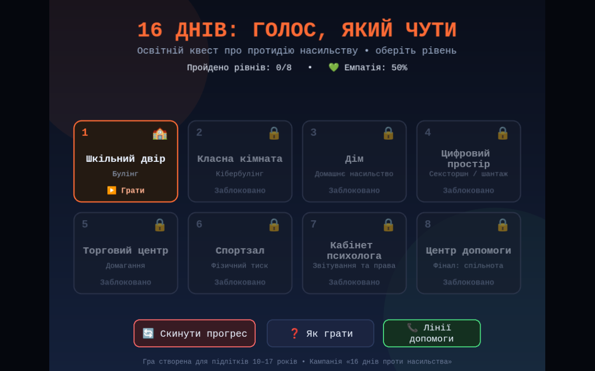

# 🎮 16 днів: Голос, який чути

Освітня інтерактивна гра (point-and-click квест / візуальна новела) для підлітків **10–17 років** на тему протидії насильству: булінг, кібербулінг, домашнє насильство, сексторшн, домагання, фізичний тиск.

Створено до кампанії **«16 днів проти насильства»**.



---

## 🚀 Як запустити

1. **Найпростіше:** відкрийте файл `index.html` у будь-якому сучасному браузері (подвійний клік). Гра працює локально без сервера та без CORS-помилок.
2. **Або через локальний сервер:**
   ```bash
   python3 -m http.server 8080
   # відкрити http://localhost:8080
   ```

Єдине зовнішнє залеження — Phaser 3 з CDN (`cdn.jsdelivr.net`), тому для першого запуску потрібен інтернет. Без інтернету гра покаже повідомлення про неможливість завантажити рушій.

## 🕹️ Як грати

| Дія | Результат |
|---|---|
| Клік на **персонажа** | Діалог із ситуацією та 2 варіантами дій |
| ✅ Правильний вибір | **+15% емпатії**, **+1 факт**, пояснення зеленим |
| ❌ Неправильний вибір | **−10% емпатії**, пояснення помилки червоним |
| Клік на **предмет, що пульсує** (артефакт) | Опис доказу, **+1 факт**, предмет сіріє |
| **3/3 фактів** | Рівень завершено → відкривається наступний |

Прогрес (поточний рівень, шкала емпатії 0–100%, зібрані артефакти, пройдені рівні) зберігається у `localStorage` браузера. Кнопка **«Скинути прогрес»** у меню очищує збереження.

## 🧩 Структура проєкту

```
.
├── index.html                  # ВСЯ гра: HTML + CSS + JS + Phaser 3 (один файл)
├── README.md
├── screenshots/                # Кадри гри для документації
└── assets/images/
    ├── backgrounds/            # Фони рівнів 1024×768 (.jpg; гра також шукає .png)
    │   ├── school_yard.jpg  classroom.jpg  home.jpg  phone_digital.jpg
    │   └── mall.jpg  gym.jpg  psychologist.jpg  support_center.jpg
    ├── characters/             # Спрайти персонажів (~200×400, прозорий фон)
    │   └── anya.png  anya_happy.png  oleg.png  marina.png  marina_brave.png
    │       teacher.png  psychologist.png  player.png
    └── objects/                # Артефакти/предмети
        └── phone.png  books.png  bench.png  notice.png
```

### Стійкість до відсутніх ассетів
У `preload()` гра намагається завантажити файли зі шляхів вище (фони — спершу `.png`, потім `.jpg`). Якщо файла немає — замість нього малюється кольоровий прямокутник-плейсхолдер із підписом (напр. `[Фон: Школа]`), тож гра **ніколи не падає** через відсутню графіку.

## ✍️ Як редагувати сценарій

Усі тексти рівнів винесені у константу **`GAME_SCRIPT`** на початку `<script>` у `index.html`. Формат об'єкта рівня:

```json
{
  "id": 1,
  "title": "Шкільний двір",
  "topic": "Булінг",
  "bgImage": "school_yard.png",
  "conclusion": "Булінг потребує втручання дорослих та підтримки свідків.",
  "artifact": { "image": "phone.png", "emoji": "📱", "label": "Телефон на землі",
                "x": 520, "y": 655, "factValue": 1, "text": "Ти знайшов телефон…" },
  "characters": [
    { "image": "anya.png", "happyImage": "anya_happy.png", "name": "Аня",
      "x": 300, "y": 725, "situation": "Аня стоїть, опустивши голову…",
      "options": [
        { "text": "…", "correct": false, "empathyChange": -10, "feedback": "…" },
        { "text": "…", "correct": true,  "empathyChange": 15, "factValue": 1, "feedback": "…" }
      ] }
  ]
}
```

Якщо `image` артефакта = `null`, використовується емодзі-плейсхолдер (`emoji`).

## 🎨 Промпти для генерації графіки

Фони та персонажі згенеровані за промптами у стилі *semi-realistic digital illustration, 4:3, no people* (фони) та *full-body sprite on solid magenta background* (персонажі, з подальшим chroma-key). Приклади:

- **Фон L1:** `Modern school courtyard in Ukraine during autumn. Yellow leaves, contemporary brick school building, wooden benches, basketball hoop. Soft overcast morning light… --ar 4:3`
- **Персонаж:** `Full-body character sprite of a sad 15-year-old Ukrainian schoolgirl… isolated on a plain flat solid magenta background (#FF00FF)…`

Щоб замінити графіку своїми файлами — просто покладіть їх за шляхами зі структури вище (фони `.png` мають пріоритет над `.jpg`).

## 🏗️ Технічні деталі

- **Phaser 3.70** (CDN), сцени: `Boot` (завантаження + плейсхолдери) → `Menu` (сітка 4×2) → `Level` (геймплей) → `Final` (статистика + контакти).
- Масштабування `Phaser.Scale.FIT` + `CENTER_BOTH`, логічний розмір 1024×768.
- Уся UI-механіка (діалоги, кнопки, HUD) — чисті Phaser-об'єкти без DOM: надійно у `file://` та sandboxed-iframe.
- Звук — процедурний WebAudio (без аудіофайлів), кнопка 🔊/🔇 у HUD.
- `localStorage` обгорнуто у `try/catch` (приватний режим браузера не ламає гру).

## 📞 Контакти допомоги (Україна)

- Дитяча гаряча лінія: **0 800 500 225** (безкоштовно)
- Ла Страда (протидія насильству): **0 800 500 335**
- Поліція: **102** | Швидка: **103**

---

*Гра є освітнім матеріалом і не замінює консультацію фахівця. Якщо ви або хтось поруч у небезпеці — телефонуйте на гарячу лінію чи 102 негайно.*
